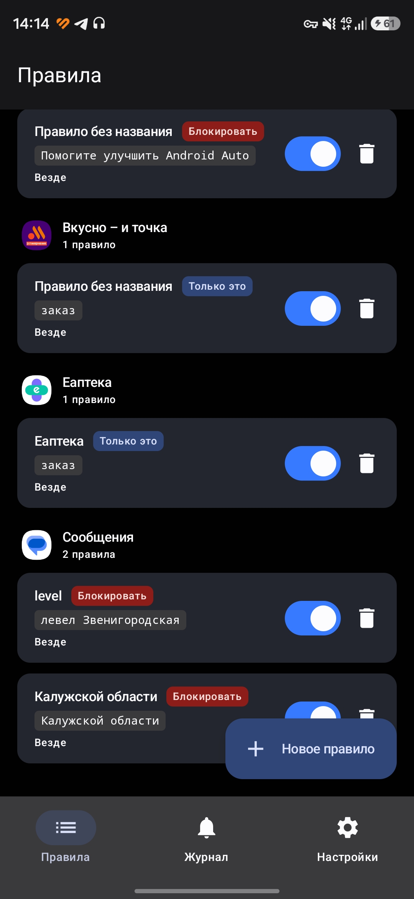
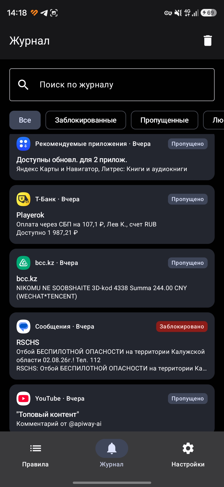
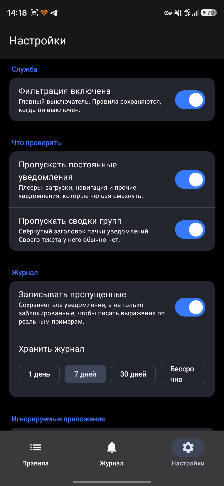

# Push Filter

**Regex notification filtering for Android.** Silence the ads an app sends without silencing the app.

[](https://github.com/Rai220/push-filter/actions/workflows/ci.yml)
[](https://github.com/Rai220/push-filter/releases/latest)
[](#requirements)
[](LICENSE)

*Русская версия: [README.ru.md](README.ru.md)*

| Rules | Log | Settings |
|:---:|:---:|:---:|
|  |  |  |

---

## The problem

Your delivery app tells you the courier is downstairs. It also tells you about a 20% discount on
sushi. Your bank confirms a payment, then offers you a credit card. Android only lets you turn
off *all* notifications from an app, or keep *all* of them.

Push Filter sits between the app and your status bar and decides per notification, using regular
expressions you write.

## Features

- **Two filtering modes.** Block what matches, or allow *only* what matches. Both can be mixed
  on the same app.
- **Per-app or global rules.** A rule targets one application or every application at once.
- **Matches the whole notification.** Title, body, big text, inbox lines and messaging-style
  conversations are all searched — ads often hide in the extras that a collapsed notification
  never shows.
- **Live regex tester.** Paste a real notification into the editor and see the verdict before
  you save the rule.
- **Notification log.** Everything that arrived, blocked or passed, with search and filters.
  One tap turns any log entry into a rule with the app and text pre-filled.
- **Ignore list.** Applications you never want touched are skipped before any other work, so a
  chatty messenger costs nothing and never reaches the log.
- **Backup.** Export and import the rules, the ignore list and every setting as readable JSON.
- **Log retention.** Keep the log for 1, 7, 30 days or forever; old entries are pruned
  automatically.
- **Private by construction.** No network permission, no analytics, no accounts. Notification
  text never leaves the device.
- **Material 3 UI** in English and Russian, with dynamic color on Android 12+.

## Install

### Download

Grab the latest signed APK from the [releases page](https://github.com/Rai220/push-filter/releases/latest)
and open it on your phone. You will need to allow installation from your browser or file manager.

With a cable:

```bash
adb install push-filter-1.3.apk
```

### First run

The app needs **notification access** — the permission that lets it read and dismiss
notifications. It cannot be granted from the app itself, so Push Filter shows a banner that takes
you to the right system screen. Find *Push Filter* in the list and enable it.

Nothing is filtered until you add a rule. Give it half an hour of normal use first, then open the
**Log** tab: you will see the real text of everything that arrived, which is what you write
patterns against.

## How a notification is judged

For every notification that arrives, in order:

1. **Is the app on the ignore list?** → left alone, not logged.
2. **Is filtering switched off?** → left alone.
3. **Is it an ongoing notification or a group summary?** → skipped, if those settings are on.
4. **Does any enabled blocking rule match?** → **blocked**. Blocking rules are a veto.
5. **Does any enabled allowing rule match?** → **passed**.
6. **Does the app have allowing rules that all failed to match?** → **blocked**. One allow rule
   turns the app into a whitelist.
7. **Otherwise** → passed.

Rules with the *All applications* target participate in steps 4–6 for every app.

That precedence is what lets the two modes coexist. You can whitelist your bank down to payment
confirmations while separately blocking one marketing phrase across every app on the phone.

## Writing rules

Patterns are ordinary regular expressions — `|`, `^`, `$`, `\d`, `{2,4}` all mean what you expect.
They are **searched anywhere** in the text, so `sale` matches `Big sale today` — you do not need
`.*` around it. Matching ignores case unless you turn on *Case sensitive*, and `^`/`$` anchor to a
line rather than the whole text. The editor keeps a few worked examples next to the field.

| Goal | Pattern | Mode |
| --- | --- | --- |
| Drop common marketing words | `sale\|discount\|promo\|% off` | Block |
| Drop Russian marketing words | `скидк\|акци\|распродаж\|промокод` | Block |
| Drop anything that starts with a label | `^Ad: ` | Block |
| Keep only payment notices | `payment\|withdrawal\|balance` | Allow only |
| Keep only messages from one person | `^Anna: ` | Allow only |
| Drop a specific recurring nag | `Rate the app` | Block |

Two shortcuts worth knowing:

- In the rule editor, **Match against** narrows the search to just the title or just the body.
  Useful when an app puts the sender in the title and you only care about that.
- In the log, **Create a rule from this** pre-fills the app and escapes the notification text
  into a literal pattern. Start there and widen it.

## Backup format

Export produces readable JSON — the rules, the ignore list and every setting — so a backup can be
edited by hand or shared:

```json
{
  "format": 2,
  "exportedAt": 1753795200000,
  "rules": [
    {
      "package": "com.example.shop",
      "name": "Promotions",
      "mode": "BLOCK",
      "pattern": "sale|discount|promo",
      "target": "BOTH",
      "caseSensitive": false,
      "enabled": true
    }
  ],
  "ignoredApps": ["org.telegram.messenger"],
  "settings": {
    "filteringEnabled": true,
    "logAllowed": true,
    "ignoreOngoing": true,
    "ignoreGroupSummary": true,
    "retentionDays": 7
  }
}
```

`mode` is `BLOCK` or `ALLOW`, `target` is `TITLE`, `TEXT` or `BOTH`, and `package` may be `*` for
a rule that applies everywhere. Every field of `settings` is optional and falls back to its
default, and a file without the object at all — anything exported before format 2 — is still
imported, leaving the settings on this phone untouched.

On import you choose whether to replace everything or add to what you already have. *Replace*
restores the settings as well; *Add* only brings in the rules and the ignore list, because there
is no sensible way to merge two switches.

## Build from source

Requires **JDK 17** and the Android SDK (compile SDK 36). No Android Studio needed.

```bash
git clone https://github.com/Rai220/push-filter.git
cd push-filter
./gradlew assembleDebug
```

The APK lands in `app/build/outputs/apk/debug/app-debug.apk`.

Run the checks the CI runs:

```bash
./gradlew testDebugUnitTest lintDebug
```

`assembleRelease` also works without any setup: when no signing key is present in the
environment, the release build falls back to the debug key so the result is still installable.

### Signing your own release

Release builds read their key from four environment variables. Nothing is ever read from a file
inside the repository.

```bash
export PUSHFILTER_KEYSTORE=/path/to/release.jks
export PUSHFILTER_KEYSTORE_PASSWORD=...
export PUSHFILTER_KEY_ALIAS=...
export PUSHFILTER_KEY_PASSWORD=...
./gradlew assembleRelease
```

To publish from a fork, add these repository secrets and push a `v*` tag:

| Secret | Contents |
| --- | --- |
| `KEYSTORE_BASE64` | The keystore file, base64 encoded (`base64 -i release.jks`) |
| `KEYSTORE_PASSWORD` | Keystore password |
| `KEY_ALIAS` | Key alias |
| `KEY_PASSWORD` | Key password |

The release workflow refuses to publish if the keystore secret is missing, verifies the signature
of the finished APK, and deletes the decoded keystore from the runner afterwards.

## How it works

A [`NotificationListenerService`](app/src/main/java/ru/krestnikov/pushfilter/filter/NotificationFilterService.kt)
receives every posted notification, extracts its text, asks the filter engine for a verdict and
calls `cancelNotification()` when the verdict is *blocked*.

```
app/src/main/java/ru/krestnikov/pushfilter/
├── data/          SQLite storage, rules, log, settings, JSON backup
├── filter/        Text extraction, regex cache, FilterEngine, the listener service
├── apps/          Installed-app labels and icons
└── ui/            Compose screens: rules, editor, log, settings
```

Design notes:

- **Rules are held in memory.** The verdict is computed on the main thread, microseconds after
  the notification is posted, so it cannot wait on disk. SQLite is the source of truth; a
  `StateFlow` snapshot is what the listener reads.
- **Compiled patterns are cached.** Recompiling a `Regex` per notification would be wasteful, and
  invalid patterns are cached as failures so a broken rule stays cheap.
- **The log is deduplicated.** Apps re-post the same notification on every progress update; the
  service drops repeats of identical content within a 5 second window.
- **No Room, no KSP.** Two tables do not justify an annotation processor and its version matrix,
  so storage is a plain `SQLiteOpenHelper` with WAL enabled.

The filtering rules are covered by unit tests in
[`FilterEngineTest`](app/src/test/java/ru/krestnikov/pushfilter/filter/FilterEngineTest.kt).

## Requirements

- Android 8.0 (API 26) or newer
- Notification access granted to the app

## Known limitations

These come from Android itself and cannot be fixed by the app:

- **A blocked notification may flash for a moment.** Listeners are notified *after* the
  notification is posted, so dismissal happens milliseconds later.
- **Sound and vibration are chosen by the sending app** and cannot always be suppressed before
  the notification is dismissed. Set the app's channel to silent if this bothers you.
- **Aggressive battery managers** on Xiaomi, Huawei, Samsung and others may kill the listener
  after a reboot. Allow the app to run in the background if filtering goes quiet.
- **Notification text is what gets matched.** Content that only exists inside a custom
  `RemoteViews` layout is not readable.

## Privacy

The app declares no internet permission. Rules, the log and settings live in the app's private
storage, are excluded from cloud backup and device transfer, and are only ever written to a file
you pick yourself via the export button.

`QUERY_ALL_PACKAGES` is declared for one reason: the rule editor lists the applications installed
on the device so you can pick one.

## License

[MIT](LICENSE)
